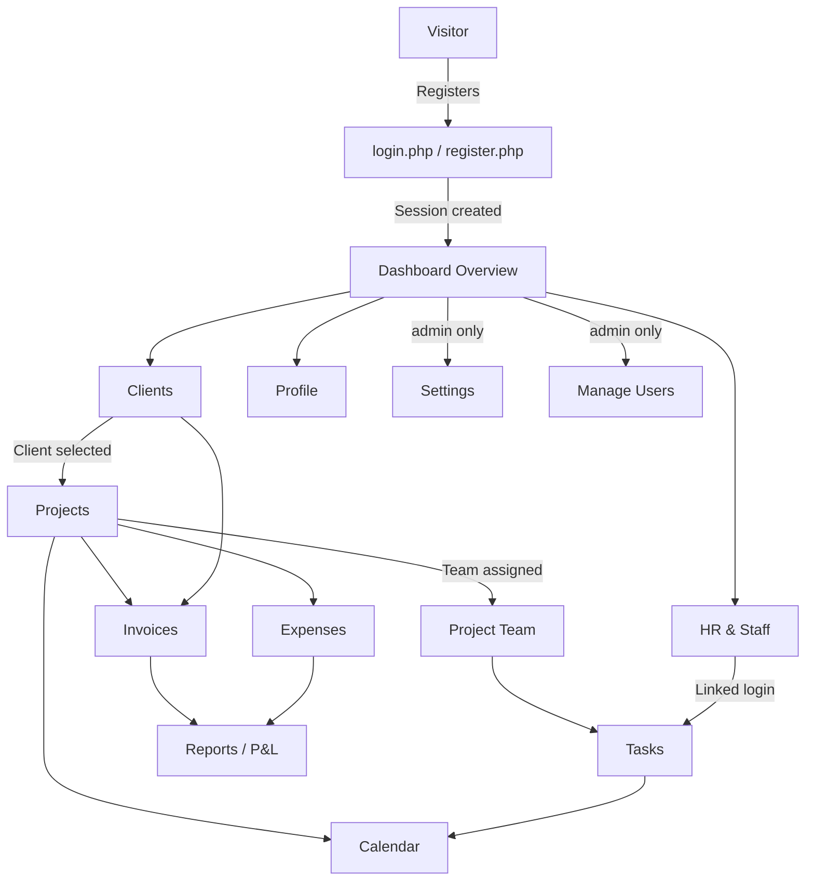
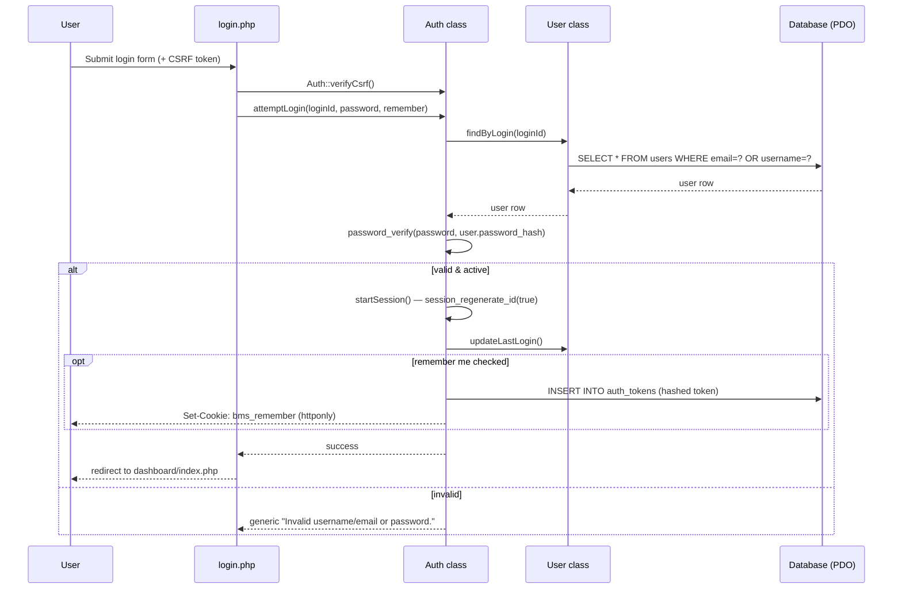

<div align="center">

# 🏢 BusinessFlow
### A Full-Stack Business Management System

**One login. One database. Every client, project, task, invoice, expense, and team member — connected.**


Developed by **Rana Umar Draz**

</div>

---

> 📄 **Companion documents in this repo:** [`INSTALLATION.md`](INSTALLATION.md) (Windows/XAMPP setup), [`TEST_REPORT.md`](TEST_REPORT.md) (test coverage), [`BUG_FIX_REPORT.md`](BUG_FIX_REPORT.md) (audit & fix history), [`PROJECT_STRUCTURE.md`](PROJECT_STRUCTURE.md) (annotated file tree), [`FINAL_CHANGELOG.md`](FINAL_CHANGELOG.md) (latest changes summary).

## Table of Contents

1. [Overview](#1-overview)
2. [The Problem It Solves](#2-the-problem-it-solves)
3. [Feature & Module List](#3-feature-module-list)
4. [Design System & UI/UX](#4-design-system-uiux)
5. [System Workflow (End to End)](#5-system-workflow-end-to-end)
6. [How Modules Connect to Each Other](#6-how-modules-connect-to-each-other)
7. [Authentication & Login Workflow](#7-authentication-login-workflow)
8. [Module Workflows in Detail](#8-module-workflows-in-detail)
   - [8.1 Client Management](#81-client-management)
   - [8.2 Project Management](#82-project-management)
   - [8.3 Project Team Assignment](#83-project-team-assignment)
   - [8.4 Task Creation, Assignment & Status](#84-task-creation-assignment-status)
   - [8.5 Calendar Integration](#85-calendar-integration)
   - [8.6 Invoicing & Billing](#86-invoicing-billing)
   - [8.7 Expense Tracking & Approval](#87-expense-tracking-approval)
   - [8.8 Reports & Profit/Loss](#88-reports-profitloss)
   - [8.9 HR & Staff](#89-hr-staff)
   - [8.10 Profile & Settings](#810-profile-settings)
9. [Database Architecture](#9-database-architecture)
10. [Backend Architecture](#10-backend-architecture)
11. [Frontend / UI Architecture](#11-frontend-ui-architecture)
12. [API / Endpoints](#12-api-endpoints)
13. [Key PHP Classes](#13-key-php-classes)
14. [Project Structure](#14-project-structure)
15. [User Roles](#15-user-roles)
16. [Technologies Used](#16-technologies-used)
17. [Local Development Requirements](#17-local-development-requirements)
18. [Installation & Setup](#18-installation-setup)
19. [Running the Project](#19-running-the-project)
20. [Login / Demo Access](#20-login-demo-access)
21. [Testing](#21-testing)
22. [Bugs Fixed](#22-bugs-fixed)
23. [Changelog Summary](#23-changelog-summary)
24. [Security Considerations](#24-security-considerations)
25. [Known Limitations](#25-known-limitations)
26. [Future Improvements](#26-future-improvements)
27. [Screenshots](#27-screenshots)
28. [Using This Repository](#28-using-this-repository)
29. [Developer / Credits](#29-developer-credits)
30. [License](#30-license)

---

## 1. Overview

**BusinessFlow** is a server-rendered, full-stack business management web application. It combines a public marketing site with an authenticated dashboard covering client relationships, project delivery, task tracking, invoicing, expense management, HR records, and system-wide reporting — all backed by a single relational MySQL/MariaDB database and an object-oriented PHP backend.

It was built as a genuine, end-to-end demonstration of full-stack fundamentals rather than a UI mockup: every button, form, and table in the dashboard is wired to a real database query through a dedicated PHP class, using prepared statements, server-side validation, CSRF protection, and role-based authorization enforced on every request — not just hidden in the interface.

---

## 2. The Problem It Solves

Small and growing businesses commonly end up running on a patchwork of disconnected tools: a spreadsheet for the client list, a separate invoicing app, a notes app for tasks, a shared inbox for HR records. Each tool has its own login and no awareness of what's happening in the others — leading to duplicated data entry and numbers that never quite reconcile between systems.

BusinessFlow keeps every one of those functions in **one relational database**, so a client created in the CRM is the exact same row a Project links to, the same client an Invoice bills, and the same client Reports aggregates revenue for — not five disconnected copies of "Acme Corp" scattered across five tools.

---

## 3. Feature & Module List

| Module | What it actually does |
|---|---|
| **Public Website** | Home, About, Services, Pricing, and Contact pages; the Contact form is a real, database-backed submission (not a `mailto:` link) |
| **Authentication** | Registration, login, logout, session handling, CSRF protection, and a database-backed "Remember Me" persistent login |
| **Client CRM** | Lead/client pipeline with status (`lead` / `active` / `inactive`), search, filtering, and full company/contact records |
| **Project Management** | Budget, timeline, priority, and live progress tracking per project; linked to a client |
| **Project Team Assignment** | Many-to-many assignment of employees to a project's team, with a role label per assignment |
| **Task Management** | A drag-and-drop Kanban board spanning every project's tasks in one view, filterable by project or assignee, plus a per-project task list on the project detail page |
| **Calendar** | Month-grid view combining task due dates, project deadlines, and invoice due dates, color-coded by type |
| **Invoicing & Billing** | Line-item invoices with automatic subtotal/tax/total calculation, a printable invoice view, and automatic overdue-status detection |
| **Expense Tracking** | Category, amount, payment method, and an approval workflow (pending / approved / rejected), optionally linked to a project |
| **Reports** | Live analytics from real SQL aggregation queries: revenue trend, project status breakdown, top clients by revenue, expenses by category, and a genuine Profit & Loss figure |
| **HR & Staff** | Employee directory with department, designation, salary, hire date, and an optional link to a dashboard login account |
| **Notification Center** | An in-app dropdown in the dashboard topbar, populated by real notification rows triggered by task assignment, new contact messages, new registrations, invoices going overdue, and admin-created accounts |
| **User & Role Administration** *(admin only)* | Create/edit dashboard accounts, assign roles, reset passwords, with safeguards against self-lockout |
| **Settings** *(admin only)* | Company profile, currency symbol, default tax rate, invoice number prefix, timezone — used live throughout Invoices and Reports |
| **Quick-Navigation Search** | A topbar search box that jumps directly to any module by typing part of its name, filtered to only the modules the current user's role can actually access |

---

## 4. Design System & UI/UX

### Visual identity
- **Palette:** white backgrounds throughout, with a navy (`#0f2a4a`) and gold (`#c9a15a`) accent system defined as CSS custom properties in `assets/css/style.css`
- **Typography:** Poppins for headings, Inter for body text (both loaded from Google Fonts)
- **Iconography:** Bootstrap Icons throughout — every nav item, stat card, and button icon
- **Logo:** a custom gold monogram (transparent PNG), used consistently in the public navbar, the dashboard sidebar, the auth screens, the footer, printable invoices, and the generated favicons

### Layout & navigation
- The **public site** uses a shared sticky navbar (`includes/header.php`) and footer (`includes/footer.php`) across every page, with Bootstrap 5's grid and utility classes for layout
- The **dashboard** uses a fixed left sidebar (`includes/sidebar.php`) that collapses behind a toggle button on smaller screens, plus a topbar (`includes/dash_header.php`) containing the quick-navigation search and the notifications dropdown
- Sidebar links are **role-aware** — "Manage Users" and "Settings" are only rendered for `admin` accounts, they don't just get hidden with CSS

### Dashboard design
- Every module page follows the same structural pattern: a page header (title + primary action button), optional stat cards, a filter/search bar, a data table or board, and add/edit via Bootstrap modals — so the interface stays predictable across all ten-plus modules rather than each one looking like a different app
- The **Kanban board** (Tasks) uses native HTML5 drag-and-drop (`draggable="true"`, `dragstart`/`dragover`/`drop` events in `assets/js/dashboard.js`) — no external drag-and-drop library
- The **Calendar** is a hand-built CSS grid (`dashboard/calendar.php`), not a plugin, with day cells populated from three separate SQL queries (tasks, project deadlines, invoice due dates) merged in PHP

### Cards, tables, forms, filters, and status controls
- **Stat cards** (`.stat-card`) use a consistent icon + value + label layout with a hover lift effect (`transform: translateY(-4px)`, defined in `assets/css/dashboard.css`)
- **Tables** (`.table-bms`) share one visual style across every module, wrapped in `.table-responsive` for horizontal scroll on small screens
- **Status badges** (`includes/badge_status.php`) are a single shared PHP partial used by every module (clients, projects, invoices, expenses, tasks, users) so a "green = active/paid/approved, red = overdue/rejected/suspended" color convention stays consistent app-wide instead of being redefined per page
- **Filters** are real `GET`-based search/filter forms (not decorative) — every list page's search box and status dropdown actually re-queries the database
- **Forms** use a shared `.form-control-bms` styling class and are validated both client-side (HTML5 `required`/`min`/`max`) and server-side (via the `Validator` class) — server-side validation is authoritative

### Responsive behavior
- Confirmed via CSS: the dashboard sidebar collapses off-canvas below 991px (`assets/css/dashboard.css`), the Kanban board's four columns stack to fewer per row on narrower viewports (Bootstrap grid classes on `dashboard/tasks.php`), and the Calendar grid compresses cell height/font size below 768px (media query in `dashboard/calendar.php`)
- The public site's hero, feature cards, and pricing tables are all built on Bootstrap's responsive grid

### Motion & interaction
- **Scroll-reveal** on the public site: elements with a `.reveal` class fade/slide into view via `IntersectionObserver` (`assets/js/main.js`) as the user scrolls — used on the marketing pages, not inside the dashboard (a deliberate choice to keep the data-dense dashboard screens free of distracting motion)
- **Animated stat counters** on the homepage count up from 0 when scrolled into view
- Hover transitions on cards, buttons, and table rows are defined via CSS `transition` properties, not JavaScript

---

## 5. System Workflow (End to End)



A person registers or logs in, lands on the **Dashboard Overview** (live stats pulled from every module), and from there moves into whichever module the task at hand requires — **Clients** to manage the pipeline, **Projects** to plan delivery, **Tasks/Calendar** to track work, **Invoices/Expenses** to manage money, **Reports** to see the aggregate picture, and **HR/Profile/Settings** for people and configuration. Every arrow above is a real foreign-key relationship or a real query joining two tables, not a conceptual diagram of unconnected screens.

---

## 6. How Modules Connect to Each Other

This is the part that separates a real system from a set of disconnected demo pages — confirmed directly from the model classes and their SQL:

- A **Client** (`clients` table) is referenced by `projects.client_id` and `invoices.client_id`. `Client::relatedRecordCounts()` actually queries both tables before allowing a delete, and blocks it if any invoices exist — preventing an accidental loss of financial history (confirmed in `dashboard/clients.php`).
- A **Project** (`projects` table) is referenced by `tasks.project_id`, `project_team.project_id`, `invoices.project_id` (optional), and `expenses.project_id` (optional). Deleting a project cascades its tasks and team assignments (`ON DELETE CASCADE` in `database/schema.sql`) but only *unlinks* invoices and expenses (`ON DELETE SET NULL`) — financial records are preserved even if the project they were originally tied to is removed.
- An **Employee** (`employees` table) can optionally be linked to a **User** login account via `employees.user_id`. This link is what makes task-assignment notifications actually reach someone — `dashboard/tasks.php` looks up the assignee's linked `user_id` before calling `Notification::notify()`.
- An **Invoice**'s `total_amount` (when `status = 'paid'`) and an **Expense**'s `amount` (when `status = 'approved'`) are both summed directly in `dashboard/reports.php` to produce the Profit & Loss figure — two different tables feeding one real calculation, not two unrelated numbers displayed side by side.
- **Settings** values (`settings` table, via the `Settings` class) are read live by `dashboard/invoices.php`, `dashboard/invoice_view.php`, `dashboard/expenses.php`, `dashboard/reports.php`, and `dashboard/index.php` for the currency symbol and default tax rate — changing a setting once changes what every one of those pages displays.
- **Notifications** are generated by five different modules writing into one shared `notifications` table: task assignment (`dashboard/tasks.php`), new contact messages (`contact.php`), new registrations (`register.php`), invoices going overdue (`Invoice::markOverdueInvoices()`, called automatically whenever the `Invoice` class is instantiated), and admin account creation (`dashboard/users.php`) — all surfaced through the same topbar dropdown (`includes/dash_header.php`).

---

## 7. Authentication & Login Workflow



- **Registration** (`register.php`) validates input via the `Validator` class, checks for duplicate email/username (`User::emailExists()` / `usernameExists()`), hashes the password with `password_hash()` (bcrypt), and always creates a `staff`-role account. Every existing admin receives an in-app notification of the new signup.
- **Login** (`login.php`) verifies the password with `password_verify()`, checks the account's `status` is `active`, and starts a session with `session_regenerate_id(true)` to prevent session fixation.
- **"Remember Me"** issues a random 32-byte token, stores its SHA-256 hash in the `auth_tokens` table (never the raw token), and sets it in an `httponly` cookie. On a later visit with no active session, `config/config.php` calls `Auth::attemptAutoLogin()`, which looks up the hash, logs the person back in, and immediately **rotates** the token (deletes the old row, issues a new one) — so a stolen cookie is only usable until the next legitimate login.
- **Logout** (`logout.php`) destroys the session and calls `Auth::clearRememberToken()`, which deletes the corresponding row from `auth_tokens` and clears the cookie — so a logged-out remember-me cookie can't be reused.
- **Authorization** is enforced with two static guards, called at the top of every dashboard page: `Auth::requireLogin()` (redirects to `login.php` if no session) and `Auth::requireRole(['admin'])` (returns an HTTP 403 if the session's role doesn't match) — used on `dashboard/users.php` and `dashboard/settings.php`.

---

## 8. Module Workflows in Detail

### 8.1 Client Management

`dashboard/clients.php` — full CRUD via a single page with Bootstrap modals for add/edit.

- **Create/Edit:** validated with `Validator::required()`/`email()` for company name, contact person, and email; status is one of `lead` / `active` / `inactive`.
- **Search & filter:** a `GET`-based search box and status dropdown call `Client::all($search, $status)`, which builds a parameterized `LIKE`/`=` query — real filtering, not client-side hiding.
- **Delete:** guarded — `Client::relatedRecordCounts()` checks for existing invoices first; if any exist, the delete is blocked with an explicit error message rather than silently cascading and destroying invoice history. If only projects are attached, those projects are unlinked (`client_id` → `NULL`), not deleted, and the client is removed.

### 8.2 Project Management

`dashboard/projects.php` (list/CRUD) + `dashboard/project_view.php` (single-project detail).

- A project is optionally linked to a client (`client_id`), with budget, start date, deadline, status (`planned`/`in_progress`/`on_hold`/`completed`/`cancelled`), priority, and a manually-set progress percentage (0–100).
- Server-side validation (`Validator::dateOnOrAfter()`) rejects a deadline set before the start date, and `Validator::range()` rejects a progress value outside 0–100 even if the HTML slider's `min`/`max` is bypassed by a direct request.
- `dashboard/project_view.php` shows the project's assigned team and task list, and is where team assignment and per-project tasks are managed (see below).

### 8.3 Project Team Assignment

Handled on `dashboard/project_view.php`, backed by the `project_team` many-to-many table.

- A dropdown lists employees **not already assigned** to this project (`Project::team()` is queried first, then filtered client-side in the form so already-assigned employees don't appear twice).
- Each assignment can carry a free-text `role_in_project` label (e.g. "Project Lead").
- Removing a team member deletes the `project_team` row but leaves the employee record and any tasks already assigned to them untouched (tasks become unassigned via `ON DELETE SET NULL` only if the *employee* is deleted, not when they're removed from a single project's team).

### 8.4 Task Creation, Assignment & Status

Two entry points into the same `tasks` table: `dashboard/tasks.php` (global Kanban board, every project) and `dashboard/project_view.php` (single project's task list).

- A task has a title, description, due date, priority (`low`/`medium`/`high`), status (`todo`/`in_progress`/`review`/`done`), a required `project_id`, and an optional `assigned_to` (an employee).
- **Status changes via drag-and-drop:** dropping a card into a different Kanban column fires a hidden form submit (`dashboard/tasks.php`'s `dragStatusForm`) that calls `Task::updateStatus()` — a real database write, not a visual-only reorder.
- **Assignment notifications:** when a task is created or reassigned to an employee who has a linked login account (`employees.user_id`), `Notification::notify()` writes a row so that person sees it in their topbar bell on their next page load.

### 8.5 Calendar Integration

`dashboard/calendar.php` builds one merged month view from three independent queries:
1. `Task::dueBetween($start, $end)` — tasks with a `due_date` in the visible month
2. A direct query against `projects` for `deadline BETWEEN ? AND ?`
3. A direct query against `invoices` joined to `clients` for `due_date BETWEEN ? AND ?` where status isn't `paid`/`cancelled`

These three result sets are merged into a single `$eventsByDay` PHP array keyed by day number, then rendered into the grid with a distinct color per type (gold = task, navy = deadline, red = invoice — see the CSS classes `.calendar-event-task`/`-deadline`/`-invoice`).

### 8.6 Invoicing & Billing

`dashboard/invoices.php` (list/create) + `dashboard/invoice_view.php` (printable single-invoice view).

- **Line items:** the "New Invoice" modal lets you add multiple description/quantity/unit-price rows via JavaScript (`assets/js/dashboard.js`'s invoice calculator), with the subtotal/tax/total recalculated live in the browser as you type — and recalculated **again, authoritatively, server-side** in `Invoice::create()`, which clamps quantity/price/tax to non-negative values regardless of what the client sent.
- **Tax & currency:** the tax percentage defaults to the company's `default_tax_percent` (from Settings) but is editable per invoice; the currency symbol shown throughout is read live from `Settings::get('currency_symbol')`.
- **Status:** `draft` / `sent` / `paid` / `overdue` / `cancelled`.
- **Automatic overdue detection:** `Invoice::markOverdueInvoices()` runs every time the `Invoice` class is instantiated (i.e. on nearly every page that touches invoices) and reclassifies any `sent` invoice whose `due_date` has passed to `overdue` — then notifies every admin. No cron job is used; this is a lazy, on-request check.
- **Printable view:** `dashboard/invoice_view.php` includes a print-specific CSS rule that hides the sidebar/topbar/footer via `@media print`, leaving a clean invoice document.

### 8.7 Expense Tracking & Approval

`dashboard/expenses.php` — full CRUD.

- Fields: category (free text, with a `<datalist>` of previously-used categories for convenience), description, amount, expense date, an optional linked project, payment method (`cash`/`bank_transfer`/`card`/`other`), and an approval status (`pending`/`approved`/`rejected`).
- Only `approved` expenses count toward the Profit & Loss calculation in Reports — a `pending` or `rejected` expense doesn't affect the numbers until an admin/manager changes its status.
- Amount is validated non-negative server-side (`Validator::range()`), independent of the HTML `min="0"` attribute.

### 8.8 Reports & Profit/Loss

`dashboard/reports.php` — every number on this page comes from a live SQL query run at page-load time, not cached or precomputed:

- **Revenue:** `SUM(total_amount) FROM invoices WHERE status = 'paid'`
- **Expenses:** `SUM(amount) FROM expenses WHERE status = 'approved'` (via `Expense::totalApproved()`)
- **Net Profit/Loss:** Revenue − Expenses, computed directly in PHP from the two query results above
- Additional breakdowns: revenue by month (last 6 months), projects grouped by status, clients grouped by industry, invoices grouped by status, expenses grouped by category, and top 5 clients by paid revenue — each its own `GROUP BY` query.

### 8.9 HR & Staff

`dashboard/employees.php` — full CRUD for the employee directory.

- Fields: employee code (auto-generated, `EMP-0001` style, via `Employee::nextEmployeeCode()`), full name, email, phone, department, designation, salary, hire date, status (`active`/`on_leave`/`terminated`).
- **Login account linking:** the employee form includes a "System Login Account" dropdown populated by `Employee::unlinkedUsers()` — users who don't already have an employee record pointing at them. Linking an employee to a user account is what allows that person to receive task-assignment notifications (see 8.4).

### 8.10 Profile & Settings

- **Profile** (`dashboard/profile.php`, any logged-in user): update your own full name and phone, and change your own password (requires the current password to be re-entered and verified with `password_verify()` before a new one is accepted).
- **Settings** (`dashboard/settings.php`, admin only): company name, email, phone, address, currency symbol, default tax rate, invoice number prefix, and timezone — stored as key/value rows in the `settings` table via the `Settings` class, and read live by Invoices, Reports, and the Dashboard Overview.

---

## 9. Database Architecture

**MySQL/MariaDB, 14 tables, InnoDB engine throughout, `utf8mb4` charset.** Confirmed directly from `database/schema.sql`:

| Table | Purpose | Key relationships |
|---|---|---|
| `users` | Dashboard login accounts | Referenced by `employees.user_id`, `clients.created_by`, `projects.created_by`, `invoices.created_by`, `expenses.created_by`, `activity_log.user_id`, `notifications.user_id`, `auth_tokens.user_id` |
| `employees` | HR staff records | `user_id` → `users` (optional, `SET NULL`); referenced by `project_team.employee_id`, `tasks.assigned_to` |
| `clients` | CRM records | Referenced by `projects.client_id`, `invoices.client_id` |
| `projects` | Project records | `client_id` → `clients` (`SET NULL`); referenced by `tasks.project_id`, `project_team.project_id`, `invoices.project_id`, `expenses.project_id` |
| `project_team` | Many-to-many: employees ↔ projects | `project_id` → `projects` (`CASCADE`), `employee_id` → `employees` (`CASCADE`), unique on the pair |
| `tasks` | Task tracking | `project_id` → `projects` (`CASCADE`), `assigned_to` → `employees` (`SET NULL`) |
| `invoices` | Billing records | `client_id` → `clients` (`CASCADE`), `project_id` → `projects` (`SET NULL`) |
| `invoice_items` | Invoice line items | `invoice_id` → `invoices` (`CASCADE`) |
| `expenses` | Business spending | `project_id` → `projects` (`SET NULL`) |
| `contact_messages` | Public contact-form submissions | Standalone (no FK) |
| `notifications` | In-app notifications | `user_id` → `users` (`CASCADE`) |
| `settings` | Company-wide key/value config | Standalone, `setting_key` as primary key |
| `activity_log` | Audit trail | `user_id` → `users` (`SET NULL`) |
| `auth_tokens` | Hashed "remember me" tokens | `user_id` → `users` (`CASCADE`) |

**Referential integrity decisions confirmed in the schema:**
- Deleting a **project** cascades its `tasks` and `project_team` rows (they're meaningless without the project) but *unlinks* its `invoices`/`expenses` rather than deleting them.
- Deleting an **employee** unlinks (doesn't delete) tasks assigned to them.
- Deleting a **user** unlinks (doesn't delete) any employee record connected to them.
- Application-layer protection goes further than the schema alone: `Client::relatedRecordCounts()` blocks deleting a client that has invoices, even though the schema's FK would technically cascade-delete them.

### Application ↔ database communication

Every database interaction in the entire application goes through **one class**: `classes/Database.php`, a PDO singleton. It exposes `select()`, `selectOne()`, `execute()`, and `lastInsertId()` helpers, all of which use PDO prepared statements with `?` placeholders (`PDO::ATTR_EMULATE_PREPARES => false`, forcing genuine server-side prepared statements). No other file in the project opens a raw `PDO`, `mysqli`, or `mysql_*` connection — confirmed by a full-codebase search.

---

## 10. Backend Architecture

The backend follows a lightweight, hand-rolled **MVC-flavored OOP structure** — no framework, but a clear separation of concerns:

- **Models** (`classes/`) — one class per business concern (`Client`, `Project`, `Task`, `Invoice`, `Expense`, `Employee`, `User`, `Notification`, `Settings`, `ContactMessage`, `ActivityLog`), each owning its own SQL. A page never writes a raw query against `$_POST` data directly; it always goes through a model method.
- **Controllers + Views** (`dashboard/*.php`, and the root-level public pages) — each page is self-contained: check authentication/authorization → validate `$_POST` input via `Validator` → call a model method → set a `Flash` message → redirect (Post/Redirect/Get) → render HTML using the data the model returned.
- **Shared services** — `Auth` (authentication/session/CSRF/RBAC/remember-me), `Validator` (input rules), `Flash` (one-time redirect messages), `ActivityLog` (audit trail writer).
- **Autoloading** — `config/config.php` registers a `spl_autoload_register()` callback that maps a class name directly to `classes/{ClassName}.php`, so no page needs manual `require` statements for the classes it uses.

---

## 11. Frontend / UI Architecture

- **No build step, no bundler, no npm.** CSS and JavaScript are plain files loaded directly by the browser (`assets/css/*.css`, `assets/js/*.js`).
- **Bootstrap 5.3** (via CDN) provides the grid, modals, dropdowns, and form controls; the project's own CSS (`style.css` for the public site, `dashboard.css` for the authenticated area) layers a custom design system on top via CSS custom properties and component classes (`.stat-card`, `.data-card`, `.table-bms`, `.badge-soft`, `.kanban-card`, etc.).
- **Vanilla JavaScript only** — no React/Vue/jQuery. `assets/js/main.js` handles the public site (scroll-reveal, navbar scroll effects, animated counters); `assets/js/dashboard.js` handles the dashboard (sidebar toggle, delete-confirmation prompts, live client-side table search, the invoice line-item calculator, Kanban drag-and-drop, and the quick-navigation search).
- **Shared partials** (`includes/`) keep the header/footer/sidebar/topbar markup in one place each, included by every page rather than duplicated.

---

## 12. API / Endpoints

BusinessFlow is a **server-rendered PHP application**, not a JSON API consumed by a separate frontend. Every dashboard page validates input, calls a model class, and renders HTML directly — there is no dedicated API layer for the core modules.

The one partial exception is `dashboard/notifications_read.php`: a small POST-only handler that marks all of the current user's notifications as read and redirects back to the referring page — it does not return JSON.

An `api/` folder exists in the project root containing only a `README.md` explaining it is **intentionally reserved** for a future phase that would add proper JSON endpoints (e.g. for a mobile client or AJAX-driven partial page updates). It is empty by design — **not** a missing or broken feature.

---

## 13. Key PHP Classes

| Class | Responsibility |
|---|---|
| `Database` | PDO singleton; the only DB connection point in the app; `select()`/`selectOne()`/`execute()`/`lastInsertId()` |
| `Auth` | `attemptLogin()`, `register()`, `logout()`, session management, CSRF token issue/verify, RBAC guards (`requireLogin()`, `requireRole()`), remember-me token issue/verify/rotate |
| `User` | Login-account CRUD, `emailExists()`/`usernameExists()` duplicate checks, admin user management (`createByAdmin()`, `updateByAdmin()`, `resetPassword()`, `countAdmins()`) |
| `Client` | CRM CRUD, `relatedRecordCounts()` delete-safety guard, `forDropdown()` for populating other modules' client selectors |
| `Project` | Project CRUD, `team()` and `tasks()` for the project detail view |
| `Task` | Global task CRUD, `updateStatus()` for Kanban drag-and-drop, `dueBetween()` for the Calendar |
| `Invoice` | Invoice + line-item CRUD, `markOverdueInvoices()` auto-detection, `totalRevenue()`/`totalOutstanding()` for stats |
| `Expense` | Expense CRUD, `totalApproved()`/`totalPending()` for stats and Reports |
| `Employee` | HR CRUD, `nextEmployeeCode()` auto-numbering, `unlinkedUsers()` for the login-account-linking dropdown |
| `Notification` | `notify()` (single user), `notifyAdmins()` (broadcast), `forUser()`, `countUnread()`, `markRead()`/`markAllRead()` |
| `Settings` | Cached key/value store; `get()`, `set()`, `setMany()`, `all()` |
| `ContactMessage` | Public contact-form CRUD and unread-count for the sidebar badge |
| `ActivityLog` | Writes and reads the audit trail (`record()`, `recent()`) |
| `Validator` | Fluent input validation: `required()`, `email()`, `minLength()`, `numeric()`, `range()`, `matches()`, `dateOnOrAfter()` |
| `Flash` | One-time session-based redirect messages (Post/Redirect/Get pattern) |

---

## 14. Project Structure

```
bms/
├── index.php, about.php, services.php,        # Public marketing pages
│   pricing.php, contact.php
├── login.php, register.php, logout.php        # Authentication
│
├── config/
│   ├── config.php               # Constants, DB credentials, autoloader, session
│   │                             # bootstrap, BASE_PATH resolution, remember-me hook
│   └── .htaccess                 # Blocks direct browser access to this folder
│
├── classes/                     # OOP backend (15 classes — see Section 13)
│   └── .htaccess                 # Blocks direct browser access to this folder
│
├── dashboard/                    # Authenticated application area (16 pages)
│   ├── index.php, clients.php, employees.php
│   ├── projects.php, project_view.php
│   ├── tasks.php, calendar.php
│   ├── invoices.php, invoice_view.php, expenses.php
│   ├── messages.php, reports.php, profile.php
│   ├── users.php, settings.php    # admin only
│   └── notifications_read.php
│
├── includes/                     # Shared layout partials
│   ├── header.php, footer.php       # Public site chrome
│   ├── dash_header.php, dash_footer.php, sidebar.php   # Dashboard chrome
│   └── badge_status.php              # Shared status-badge component
│
├── assets/
│   ├── css/style.css              # Public site design system
│   ├── css/dashboard.css          # Dashboard design system
│   ├── js/main.js                 # Public site interactions
│   ├── js/dashboard.js            # Dashboard interactions
│   └── images/                    # Logo + generated favicons
│
├── database/
│   ├── schema.sql                 # Full schema (14 tables) + seed data
│   └── .htaccess
│
└── api/
    └── README.md                  # Explains this folder is reserved (see Section 12)
```

A fully annotated version of this tree — including a line for every single file — is in [`PROJECT_STRUCTURE.md`](PROJECT_STRUCTURE.md).

---

## 15. User Roles

Enforced via the `role` column on `users`, checked **server-side on every request** (not just hidden in the UI):

| Role | Access |
|---|---|
| **staff** | Default role for self-registered accounts. Full create/view/edit across Clients, Projects, Tasks, Calendar, Invoices, Expenses, HR, Messages, Reports, and own Profile. **Cannot delete** records; cannot access Manage Users / Settings. |
| **manager** | Everything `staff` can do, plus permission to **delete** records (clients, projects, employees, invoices, expenses, tasks, project team members). Still cannot access Manage Users / Settings. |
| **admin** | Everything `manager` can do, plus exclusive access to **Manage Users** and **Settings**, guarded by `Auth::requireRole(['admin'])` (a real HTTP 403 if bypassed by direct URL). |

Public self-registration always creates a `staff` account by design. Promoting an account to `manager`/`admin` requires an existing admin, via **Manage Users**.

---

## 16. Technologies Used

| Layer | Technology |
|---|---|
| Markup & Styling | HTML5, CSS3 (custom design system, no CSS framework beyond Bootstrap) |
| UI Framework | Bootstrap 5.3 (via CDN) |
| Client-side scripting | Vanilla JavaScript — no framework, no jQuery |
| Server-side language | PHP 8+, object-oriented throughout |
| Database | MySQL / MariaDB, `PDO` with prepared statements |
| Icons | Bootstrap Icons |
| Fonts | Google Fonts — Poppins, Inter |

**No other frameworks or libraries are used.** No React/Vue/Angular, no Laravel/Symfony, no npm build pipeline — confirmed by inspecting every `<script src>`/`<link href>` in the codebase, all of which point to either a CDN (Bootstrap, Bootstrap Icons, Google Fonts) or a local, hand-written file.

---

## 17. Local Development Requirements

- PHP 8.0+ with the `pdo_mysql` extension enabled (confirmed working on PHP 8.2.12)
- MySQL 5.7+ or MariaDB 10.3+ (confirmed working on MariaDB 10.4.32)
- Apache, or any server capable of running PHP + `.htaccess` (confirmed on Apache 2.4.58 via XAMPP)

---

## 18. Installation & Setup

### Quick steps
1. Copy the entire project folder into your web server's document root (e.g. `htdocs/bms` for XAMPP).
2. Import `database/schema.sql` into a database named `bms_db` (creates all 14 tables + seed data).
3. Confirm `config/config.php`'s DB constants match your local MySQL/MariaDB setup.
4. Start Apache and MySQL/MariaDB, then visit the project in your browser.

### XAMPP + Apache + MariaDB/MySQL setup

This project has been configured and audited against a confirmed working environment: **XAMPP on Windows, Apache 2.4.58, PHP 8.2.12, MariaDB 10.4.32.**

1. Place the project folder at `C:\xampp\htdocs\bms\` (or your platform's equivalent web root).
2. Start **Apache** and **MySQL** from the XAMPP Control Panel.
3. Open `http://localhost/phpmyadmin`, create a database named `bms_db`, then use its **Import** tab to import `database/schema.sql`. (Every `CREATE TABLE` uses `IF NOT EXISTS`, so re-importing is always safe.)
4. Visit `http://localhost/bms/`.

Full click-by-click steps, including troubleshooting for common port/permission issues, are in [`INSTALLATION.md`](INSTALLATION.md).

### Database configuration

`config/config.php` defines the connection constants:

```php
define('DB_HOST', '127.0.0.1');
define('DB_PORT', '3307');
define('DB_NAME', 'bms_db');
define('DB_USER', 'root');
define('DB_PASS', '');
```

**Port note:** this project ships pre-configured for **port 3307** — a common XAMPP situation where MariaDB gets moved off the standard port 3306 because another MySQL service already occupies it. If your MySQL/MariaDB instance uses the standard port, change `DB_PORT` to `'3306'`. A mismatched port here is the single most common cause of a "database connection failed" error — see [`BUG_FIX_REPORT.md`](BUG_FIX_REPORT.md) for the full diagnosis of exactly this issue, previously found and fixed in this project.

---

## 19. Running the Project

1. Visit `http://localhost/bms/` (adjust to match where you placed the folder).
2. Register an account, or log in if you already have one.
3. From the Dashboard, try the connected workflow end to end: add a **Client** → create a **Project** for them → assign a **team member** → add a **Task** and drag it across the Kanban board → log an **Expense** against the project → raise an **Invoice** and mark it paid → check **Reports** for the updated Profit & Loss and **Calendar** for the due dates.
4. As an admin, visit **Manage Users** and **Settings** to see the admin-only areas.

---

## 20. Login / Demo Access

`database/schema.sql` seeds a placeholder `admin` user (username `admin`, email `admin@bms.com`) with a password hash included as seed data. **This hash's actual plaintext password is not confirmed/guaranteed in the current implementation** — treat it as a placeholder rather than a working demo password, per the project's own setup notes in the schema file.

**Recommended path to a working login:**
1. Open `register.php` and create a real account (this always creates a `staff`-role account).
2. In phpMyAdmin, open the `users` table, find your new row, and change its `role` column from `staff` to `admin`.
3. Log out and back in — you'll now see **Manage Users** and **Settings** in the sidebar.

No real credentials, API keys, or secrets are included anywhere in this repository or this README.

---

## 21. Testing

This project's most recent audit pass was verified through **static code analysis and manual line-by-line code tracing** rather than an automated test suite (none is included — see [Known Limitations](#25-known-limitations)). Areas covered:

- PHP structural integrity (brace/parenthesis balance) across every file
- Every `include`/`require` path resolves to a real file
- Every internal link and asset reference resolves to a real file
- Every database column referenced in code matches the actual schema
- Every dashboard page enforces `Auth::requireLogin()` or `Auth::requireRole()`
- Every state-changing form carries and verifies a CSRF token
- SQL injection and XSS resistance, traced through every form's handling code
- Full end-to-end workflow tracing: Client → Project → Team → Tasks → Expenses → Invoice → Reports; Employee → linked login → Task notification; Contact/Registration → admin notification; RBAC boundaries for each role

A complete, itemized, test-by-test breakdown — including an honest split between what was confirmed via static analysis versus what still needs confirmation on a live running server — is in [`TEST_REPORT.md`](TEST_REPORT.md).

---

## 22. Bugs Fixed

The project underwent a focused audit and repair pass to resolve a reported database-connectivity issue. In summary:

| Issue | Root Cause | Fix |
|---|---|---|
| Registration/login/DB features failing | The PDO connection string had no `port=` parameter, so it couldn't reach MariaDB running on a non-default port (3307) | Added `DB_PORT` to `config/config.php` and included it in the DSN in `classes/Database.php` |
| DB errors hard to diagnose | The connection-failure handler discarded the real `PDOException` message | Now shows the real error during development (`display_errors` on), falls back to a safe generic message in production |
| Potential broken asset/link paths on Windows | `BASE_PATH` resolution used a case-sensitive path comparison, which Windows's case-insensitive filesystem could defeat | Switched to a case-insensitive comparison |

Full root-cause analysis, exact before/after code, and verification method for each issue is documented in [`BUG_FIX_REPORT.md`](BUG_FIX_REPORT.md).

---

## 23. Changelog Summary

- **Fixed:** database connectivity (missing port in DSN), connection-error visibility, a Windows path-casing edge case
- **Added:** `.gitignore`, and this documentation suite (`BUG_FIX_REPORT.md`, `TEST_REPORT.md`, `PROJECT_STRUCTURE.md`, `INSTALLATION.md`, `FINAL_CHANGELOG.md`)
- **Unchanged:** every page, class, stylesheet, script, the database schema, the visual design, and all existing business logic — confirmed already correct and left untouched

Full details in [`FINAL_CHANGELOG.md`](FINAL_CHANGELOG.md).

---

## 24. Security Considerations

Features actually implemented and confirmed in the codebase:

- **Password hashing** — `password_hash()` (bcrypt) / `password_verify()`; passwords are never HTML-escaped or logged
- **SQL injection protection** — 100% PDO prepared statements with bound parameters; `PDO::ATTR_EMULATE_PREPARES` disabled to force genuine server-side prepares
- **XSS protection** — `htmlspecialchars()` applied to user-supplied text, both at input time (`Validator::clean()`) and at output time
- **CSRF protection** — every state-changing form carries a token verified via `Auth::verifyCsrf()`
- **Session security** — `session_regenerate_id(true)` on login to prevent session fixation
- **Remember-me token security** — tokens are stored as SHA-256 hashes (never the raw token), delivered via an `httponly` cookie, and rotated on every automatic re-login
- **Role-based access control** — enforced server-side on every request (delete actions, admin-only pages), not just hidden UI elements
- **Directory protection** — `.htaccess` files in `config/`, `classes/`, and `database/` deny all direct browser access to those folders
- **No credential leakage** — the database connection error handler shows detailed errors only when `display_errors` is on (development), falling back to a generic message otherwise

---

## 25. Known Limitations

- No automated test suite (PHPUnit or similar) — verification is via static analysis and manual code tracing (see [`TEST_REPORT.md`](TEST_REPORT.md))
- No automated database migrations — `database/schema.sql` is a single file, imported once
- No outbound email — the notification system is in-app only; nothing sends real emails
- No file uploads anywhere in the system
- The Pricing page is informational only — no payment processing is wired up
- `api/` is an intentionally empty, reserved folder — there is no JSON API yet

---

## 26. Future Improvements

**These are ideas for future work — none of the following currently exist in the codebase:**

- File attachments (project files, invoice PDFs)
- Outbound email notifications, in addition to the existing in-app notification center
- Subscription/billing plan enforcement
- CSV/PDF export for Reports and invoices
- Attendance and leave management as an HR extension
- A dedicated audit-log viewer (the data is already captured in `activity_log`; only a browsing UI is missing)
- JSON API endpoints (the `api/` folder is reserved for exactly this)
- Task comments/attachments on the Kanban board

---

## 27. Screenshots

*No screenshots are currently included in this repository. Suggested structure for adding them:*

```
docs/
└── screenshots/
    ├── homepage.png
    ├── dashboard-overview.png
    ├── clients.png
    ├── kanban-board.png
    ├── calendar.png
    ├── invoice-view.png
    └── reports.png
```

```markdown

```

---

## 28. Using This Repository

```bash
git clone <your-repository-url>
cd bms
# Follow Section 18 (Installation & Setup) to configure and run locally
```

No secrets or environment-specific credentials beyond the local development DB password (empty, matching a default XAMPP `root` account) are present in this repository — see `.gitignore` for what's deliberately excluded from version control.

---

## 29. Developer / Credits

**Developer:** Rana Umar Draz

The project's logo is the developer's own supplied artwork, integrated throughout the site. Contact/social links are intentionally left as placeholders in `config/config.php` (`DEV_LINKEDIN`, `DEV_INSTAGRAM`, `DEV_GITHUB`, `DEV_EMAIL`) rather than invented.

---

## 30. License

No open-source license has been formally attached to this project. If publishing publicly, consider adding an explicit `LICENSE` file (e.g. MIT) based on how you intend the code to be reused.
